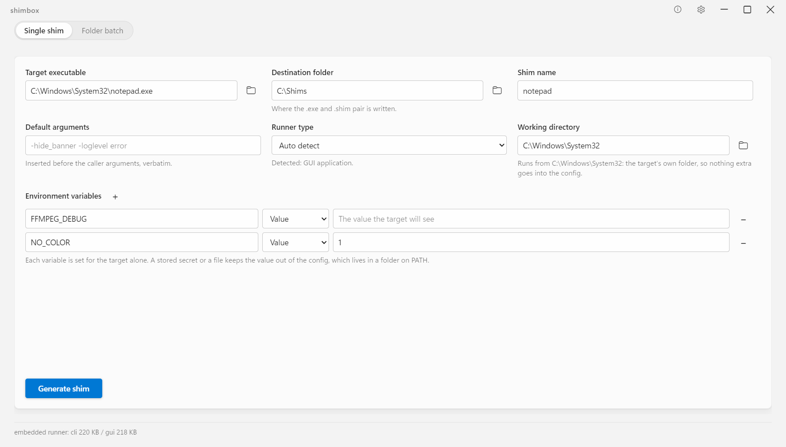
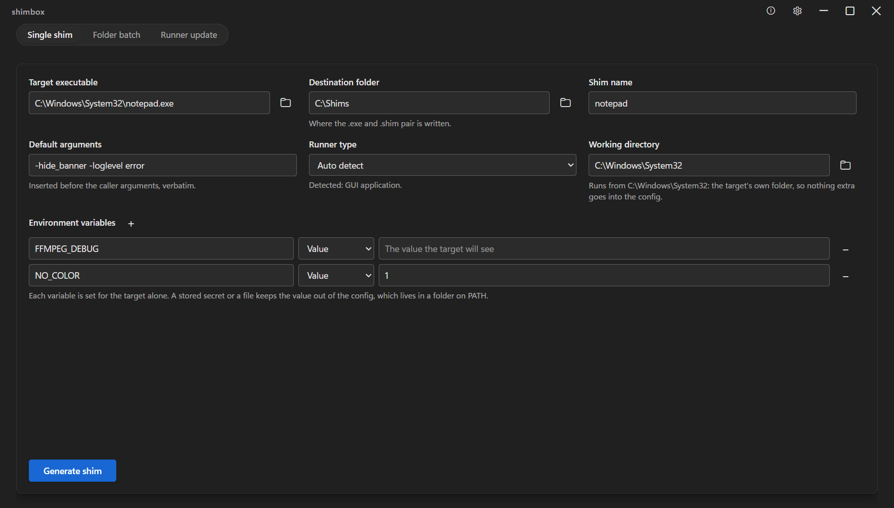
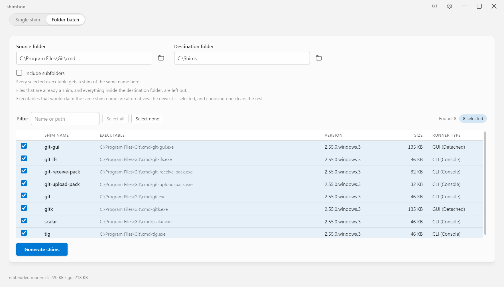
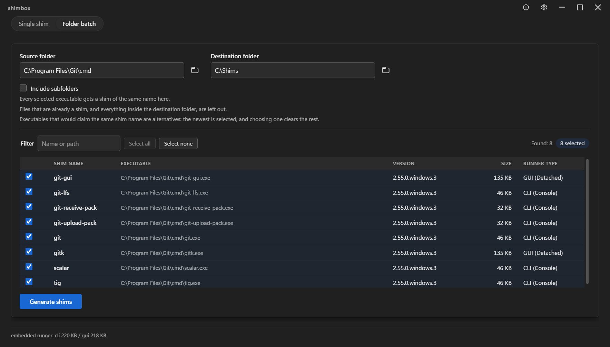

# shimbox

[](https://github.com/goloveshko/shimbox/releases/latest)
[](https://github.com/goloveshko/shimbox/actions/workflows/ci.yml)
[](LICENSE)


**[Download the portable archive](https://github.com/goloveshko/shimbox/releases/latest)** —
one `shimbox.exe`, nothing to install, no service and no registry writes. Its checksum
sits beside it on the same page.

A tiny executable-shimming tool for Windows. It puts a small proxy `.exe` next
to a flat config file in one folder, you put that folder on `PATH`, and from
then on the tool answers to a name you chose — with the arguments it always
needs, the working directory it expects, and the environment variables it looks
for, all supplied without touching the original binary.

Typical uses: a portable tool that only runs from its own folder, a build of
`ffmpeg` you would rather call `video`, a program that must be started with
`-some-flag` every single time, or a CLI that has to be given a token your
scripts should not carry in plain text.

Two parts, one workspace:

| Part | What it is |
| :--- | :--- |
| `shim-runner` | A ~220 KB Rust executable built in two variants (console subsystem, windows subsystem). It finds the config named after itself, reads it, and launches the target with your arguments. |
| `shimbox` | A Tauri v2 desktop app that writes those pairs: one shim at a time, or a whole directory at once. |

v1 **generates**. It does not list, inspect, re-point or delete shims that
already exist — see `docs/techspec.md` 8 for that and the other deferred items.

## The manager

One window, three screens: a single shim whose every field you set yourself, a
whole folder scanned into a table, and the shims this machine already holds that a
newer runner has not reached. Light and dark, and the same in Russian.

| Light | Dark |
| :--- | :--- |
|  |  |
|  |  |

## How a shim works

A shim is two files that share a base name, in the same folder:

```text
C:\Shims\video.exe     a copy of one runner variant
C:\Shims\video.shim    the config it reads at launch
```

The runner locates itself on disk, so `video.exe` reads `video.shim` beside it
and nothing else — renaming or moving the pair renames or moves the command.
Arguments you type are forwarded to the target byte-for-byte, stdin/stdout and
the exit code are inherited, and the console or window behaviour comes from
which variant was copied: the manager picks that from the target's PE header
unless you override it.

## Build

Windows only, and it needs the MSVC toolchain, `cargo` and the WebView2 runtime
(already present on Windows 11). A first clone also needs Node and one
`npm install` in `apps\gui`, because the build checks the UI with Prettier and
says so when the formatter is not installed. The order matters: the manager
embeds the runner's bytes, so the runner is built and staged first.
`scripts\build.cmd` does the whole thing. The manager is staged into `bin\`
as a hard link rather than a copy, and one thing follows from that: while a
shimbox window is open, Windows will not hand over the name the program was
started from, so that build says it staged nothing and finishes anyway. Close
the window and the next build links the new bytes.

```powershell
scripts\build.cmd                     # both runner variants, tests, the manager
scripts\build.cmd -Profile debug      # the same, unoptimized
scripts\test.cmd                      # runner and tests, no manager
scripts\smoke.cmd                     # end-to-end runner checks against real binaries
scripts\package.cmd                   # the release archive out of bin\
```

Each `.cmd` is a wrapper of two lines over a `scripts\*.ps1` master, which
is where the logic lives; `smoke.cmd` and `package.cmd` read `bin\`, so build
first. Double-clicking a wrapper leaves the window open until you press a key —
`-NoPause`, or `SHIMBOX_NO_PAUSE=1` in the environment, skips that. The results
land in `bin\`:

```text
bin\runner-cli.exe   console-subsystem runner   (target: under 400 KB)
bin\runner-gui.exe   windows-subsystem runner   (target: under 400 KB)
bin\shimbox.exe      the manager, one more name for target\release\gui.exe
```

Building just the manager with `cargo build -p gui` fails on purpose until
`bin\` holds a runner, because embedding a stale runner is the one mistake this
layout makes easy to miss.

Both runners are embedded into `shimbox.exe` and written out beside a `.shim` when
one is generated, so a release carries the manager alone.

`scripts\package.cmd` wraps that one file into
`bin\shimbox-<version>-windows-x64.zip`, with this README and the license beside
it. The version is read from the workspace `Cargo.toml`, and a `v*` tag that
disagrees with it stops the package rather than shipping a mismatched pair.

The same three scripts run on every push to `main` and on every pull request
(`.github\workflows\ci.yml`), on a Windows runner and under Windows PowerShell —
and there the runner size target is a failed build rather than a line in the log.
The two formatting checks the build opens with are a failed build everywhere, on
the runner and on a double-click, because the answer to them is a command rather
than a judgement.
A `v*` tag additionally gets a **draft** release holding the archive: publishing
one, and writing the text the app's own update card shows, stays a human step.

## Setup

1. Make a folder for the shims, for example `C:\Shims`.
2. Put it on `PATH`: *Settings → System → About → Advanced system settings →
   Environment Variables*, edit `Path`, add the folder. A successful result whose
   folder is not there yet has an **Edit PATH…** button that opens that same
   window; when the folder is already on `PATH`, the card says so instead.
3. Open `bin\shimbox.exe`, generate shims into the folder.
4. Start a **new** terminal — `PATH` is read when a process starts — and run the
   name you gave the shim.

Adding the folder to `PATH` is yours to do: shimbox opens the system editor for
convenience but never writes the variable itself. Until the folder is on `PATH`
the shim is simply not found, which is expected rather than an error.

## Using the manager

**Single shim** — pick the target executable, get its file stem offered as the
name and its own folder as the working directory, then adjust: alias, the
destination folder, arguments, runner variant, and the environment variables the
target runs with.
The `Generate` button waits until the target, the destination and the name are
all filled in.
Arguments are written into the config exactly as you type them, with no quoting
added.

A variable's value is either typed into the config, read from a file at launch, or
a stored secret. Secrets go to Windows Credential Manager under `shimbox/<name>`.
The card holding them opens from a secret row's own picker — its last line reads
**Manage secrets…**, or **Save a first secret…** while nothing is stored yet — and
the name you store there goes straight into the row that asked for it. One card
serves every row, so a token is typed once and referenced by as many shims as need
it.

**Folder batch** — pick a source directory, scan it (subdirectories optional),
and tick what to shim. The table shows the detected runner type, the file
version and the size for every candidate, and a filter narrows it without
touching the selection. Files that would claim the same command name are
alternatives rather than a set of checkboxes: the newest is preselected and
choosing another clears its rivals. A rescan keeps what you had chosen by hand.
Batch shims get `path` only — no per-entry arguments or environment; open the
single-shim screen for those. A file that is already a shim is left out of the
scan, and a name that turns out to be taken is skipped with the reason printed
in the summary; the single-shim screen refuses to overwrite it and says so in
the dialog instead.

**Update runners** — a shim is a copy of a runner, so a fix released later reaches
none of the shims made before it. The third tab lists the pairs whose `.exe` is not
this build's bytes: the folder named in the field, or, while it names nothing,
every folder on `PATH`. Only a file that names shimbox *and* one of its two runner
binaries in its own file properties is ever listed, so another tool's shims in a
folder on `PATH` stay untouched — and so does the manager, which carries our product
name without a runner's. Ticking
a row writes that runner and the one `runner` line that says which bytes are in it;
every other line of the config goes back exactly as it came, so nothing you set is
lost. A shim that is running now fails on its own row with the reason, and the rest
of the list is still updated. Its result card names what was written and what did not
take, and offers no folder to open: the folder was already on `PATH` to be found
there.

The result of the other two modes is a card you can dismiss by clicking anywhere
around it, with **Open destination folder** when something was written, and **Edit
PATH…** unless the folder is already on `PATH`. That last answer is the variable
the manager was started with, so an entry you added while its window stayed open
is a reminder you see one more time.

Every Browse button reopens in the folder you last chose for that field — kept in
`$APPCONFIG/.pickers.json` and restored across restarts — so the destination
dialog no longer opens wherever the target's dialog ended.

The titlebar is ours rather than the system's: the name at the left, and at the
right **About**, **Settings**, minimize, maximize/restore and close. Drag the
window anywhere along the strip, or double-click it to maximize. **Settings**
offers Light, Dark or following Windows, and applies as you pick it — kept in
`$APPCONFIG/.settings.json`, so it is still there next run. Below it, the same
card asks which language to speak: English, Русский, or following Windows again.
A language applies the same way, and what is already typed into the form stays
where it is. **About** shows the
version — click it and it is on the clipboard — the sizes of the runners built into
this binary, and the license, author and repository lines, each of which opens in
your browser rather than in this window. The last row names the folder this app keeps
its own files in, which is the first thing a report of a strange build asks for, and
opens it.

A newer release is found rather than installed: a few seconds after the window
opens, and at most once a day, the manager asks GitHub for this repository's latest
release. When that number is ahead of the one this build carries, a card shows both
of them with the release notes, and **Open release** takes you to the release page
in your browser. The only thing kept about it is the moment of the ask, in
`$APPCONFIG/.update.json`, so a day of restarts asks once; an ask that goes
unanswered — offline, or a repository with no release yet — stays quiet. This is the
app's only network request, and it is the same one a browser makes to read a release
page.

## Configuration reference

`<alias>.shim` is UTF-8, one `key=value` per line, split on the **first** `=`.
Values are taken verbatim: no quoting, no escapes, no trimming, so backslashes
and spaces mean exactly what they say. A line starting with `#` is a comment and
unknown keys are ignored.

`.shim` is also the extension Scoop uses for a file of the same purpose, and the
two formats are not interchangeable in either direction: Scoop separates a key
with a spaced `=` and quotes its path, so a Scoop file read here keeps those
quotes as part of the value and the runner reports it instead of guessing, and a
file written here is one Scoop cannot read at all. The comparison, and why the
name is kept anyway, is in `docs/techspec.md` 3.6.

| Key | Required | Meaning |
| :--- | :--- | :--- |
| `runner` | written, read only when its `.exe` is gone | `<variant>@<version>` of the bytes copied in as the `.exe` half. A later build compares the bytes themselves — the copy carries its own version in its file properties — so this line is what a config left without its runner has to say about itself. The runner itself is those bytes already and ignores the line. |
| `path` | yes | Absolute path to the target executable. |
| `arg` | no, repeatable | Argument inserted before the caller's own, exactly as written. |
| `workdir` | no | Working directory for the child. Without it the child starts in **the target's** directory, not the caller's. |
| `env` | no, repeatable | `NAME=value` for the child. For parameters, not secrets. |
| `envref` | no, repeatable | `NAME=reference`; the value is read when the shim runs, so it never sits in the file. |

```ini
# shimbox config
runner=cli@1.0.0
path=C:\Tools\ffmpeg\bin\ffmpeg.exe
arg=-hide_banner
workdir=C:\Tools\ffmpeg
env=FFMPEG_DEBUG=1
envref=GITHUB_TOKEN=cred:shimbox/github
```

An `envref` points at one of two places:

| Reference | Reads |
| :--- | :--- |
| `file:<path>` | The whole file, without its trailing newlines. |
| `cred:<target>` | A generic credential from the Windows Credential Manager. |

The manager stores secrets as `shimbox/<name>` credentials and offers only names
it wrote itself; one stored value can be referenced by any number of shims, each
calling it whatever its target expects. A credential is a DPAPI blob your own
session can decrypt, so this keeps values **out of the file**, not out of reach
of anything running as you. Unresolvable references fail loudly instead of
starting the child without a value it wanted.

## Repository layout

```text
crates\runner           the shim runner, both variants from one source
apps\gui\src-tauri      the manager's Rust commands (scan, generate, secrets)
apps\gui\ui             its frontend: plain HTML, CSS and ES modules
docs\techspec.md        the specification every change is made against
docs\images             the screenshots above
scripts                 build, test and smoke entry points
bin                     staged artifacts (git-ignored)
```

The UI has no build step and no npm dependencies; it is embedded into
`shimbox.exe` at compile time, so a UI change needs a rebuild to show up. Every
string goes through a `data-i18n` key with one dictionary per language, so a
language is one file in `apps\gui\ui\locales` plus three lines in `i18n.js` (the
import, and its entry in `languages` and `dictionaries`) — the
two registered today are English and Russian.

## Notes

- **Unsigned**: the shape is a small unsigned executable that calls
  `CreateProcess`, copied under many different names, which is a realistic
  SmartScreen or Defender false positive. Signing is the mitigation that
  actually works; see `docs/techspec.md` 6.
- **No `.bat` / `.cmd` / `.ps1` targets** in v1; the runner launches `.exe`
  files directly.

---

## 🔒 Security

Report a vulnerability privately through a [GitHub Security Advisory](SECURITY.md),
not a public issue. [The policy](SECURITY.md) says what the code holds, what is
worth reporting and what is not.

---

## 📄 License

This project is licensed under the [MIT License](LICENSE).

---

## 👨‍💻 Author & Support

Developed with ❤️ by [Sergey Goloveshko](https://sergey.is-a.dev) — **AI & Systems Engineer**.

- **Portfolio**: [sergey.is-a.dev](https://sergey.is-a.dev)
- **Telegram Support**: [@itz2bot](https://t.me/itz2bot?start=shimbox_page_readme)
- **Report an Issue**: [GitHub Issues](https://github.com/goloveshko/shimbox/issues)
